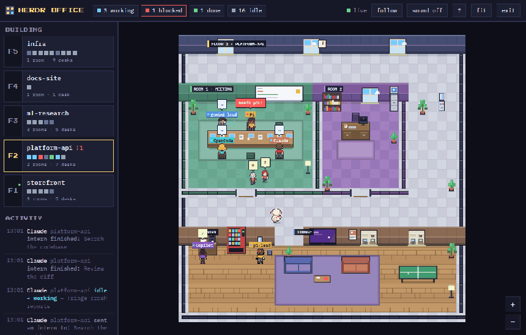
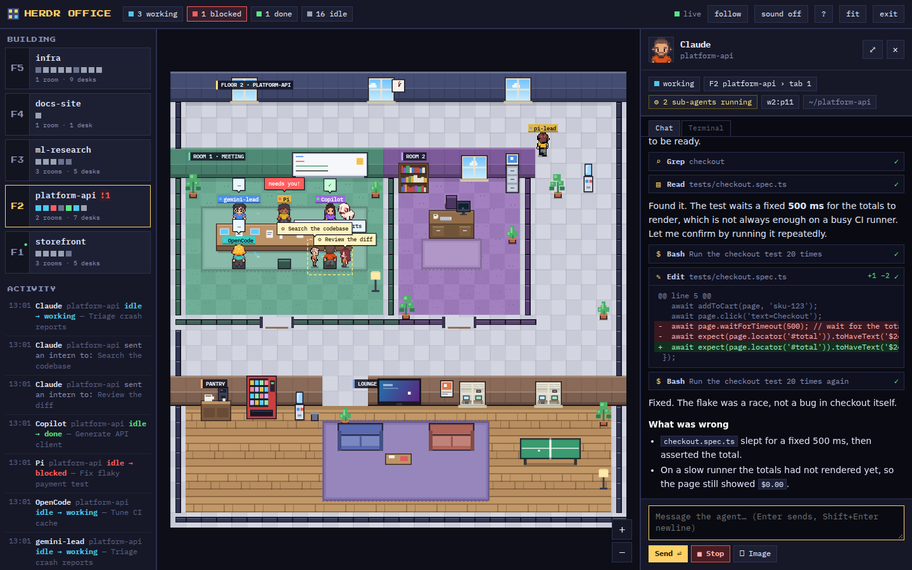
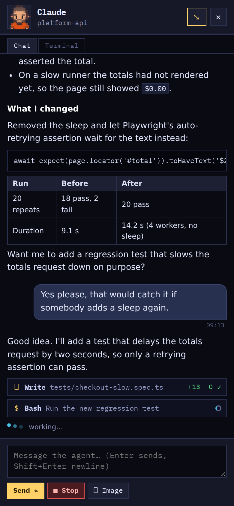
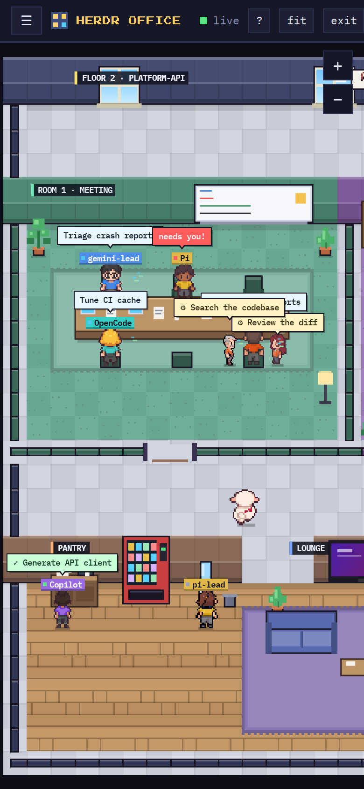

<div align="center">


# Herdr Office

**Your terminal agents, working in a tiny pixel-art office.**<br>
A virtual office for your [herdr](https://herdr.dev) session, with a proper chat view for Claude Code, Cursor and Codex.

[](LICENSE)
[](#install)
[](#how-it-works)
[](#develop)

[**Try it**](#try-it-in-30-seconds) · [Prerequisites](#prerequisites) · [Features](#features) · [Chat view](#chat-view) · [Install](#install) · [Phone & deploy](#on-your-phone) · [Contribute](#contributing)



</div>

---

Every herdr **workspace is a floor**, every **tab is a room**, every **pane is a desk**. An agent gets a little
worker who types while it works, waves when it needs you, cheers when it finishes, and wanders off to the pantry
when it has nothing to do. Click a worker and read the agent's conversation as a real **chat**, not a terminal dump,
and answer from your browser or your phone.

```
workspace  ->  floor            agent working  ->  types at the desk, bubble = what it is doing
tab        ->  room             agent blocked  ->  waves, red "needs you!" bubble, the sheep runs over
pane       ->  desk / seat      agent done     ->  cheers at the desk, then wanders off
shell pane ->  empty desk       agent idle     ->  coffee, couch, ping-pong, a look out of the window
sub-agent  ->  an intern        night time     ->  everyone goes back to their desk and sleeps
```

<table>
<tr>
<td width="62%"></td>
<td width="38%"></td>
</tr>
<tr>
<td align="center"><sub><b>Chat view</b>: bubbles, markdown, collapsible tool cards with real diffs</sub></td>
<td align="center"><sub><b>On your phone</b>: full-screen chat, Enter sends</sub></td>
</tr>
</table>

## Try it in 30 seconds

No herdr, no setup, nothing to install. It is plain Node.

```bash
git clone https://github.com/fandyaditya/herdr-office && cd herdr-office
npm run demo          # -> http://127.0.0.1:4747
```

The demo is a made-up building whose agents change state over time, with a sample conversation in every chat. Every
screenshot in this README is taken from it, so nothing private is shown.

## Prerequisites

Herdr Office draws a [herdr](https://herdr.dev) session, so install and start herdr first. (Just curious? Skip this and
run `npm run demo`.)

**1. Install herdr** (one binary; macOS, Linux and Windows):

```bash
curl -fsSL https://herdr.dev/install.sh | sh     # macOS / Linux
brew install herdr                               # Homebrew
mise use -g herdr                                # mise
```

Windows (PowerShell): `irm https://herdr.dev/install.ps1 | iex`. Nix and manual downloads are covered in the
[herdr install guide](https://herdr.dev/docs/install/). If your shell cannot find `herdr` afterwards, open a new terminal.

**2. Start herdr and put an agent in a pane.** Run `herdr`: it launches (or attaches to) a persistent session. Open a
workspace, then start Claude Code, Cursor CLI, Codex CLI or any [agent herdr detects](https://herdr.dev) in a pane.
`herdr status` shows that its background server is up. That server's socket (`~/.config/herdr/herdr.sock`) is what the
office connects to.

**3. Node 20 or newer**: `node --version`.

Herdr Office itself is tested on Linux; the Cursor and Codex chat adapters read `/proc`. macOS and WSL reports are
welcome.

## Install

```bash
git clone https://github.com/fandyaditya/herdr-office && cd herdr-office
npm start             # first run creates .env with a fresh access token and prints it
```

Open the printed URL, log in with the token, done. By default it listens on `127.0.0.1` only.

| Command | What it does |
|---|---|
| `npm start` | Run against your herdr. `--port 5000`, `--host 0.0.0.0,...`, `--open` also work: `npm start -- --open` |
| `npm run demo` | The demo building, no herdr, no login (loopback only). |
| `npm run doctor` | Checks Node, the token, herdr's socket, the port and which agents it can read. Tells you what to fix. |
| `npm run check` | Syntax, house rules and all tests, for contributors. |
| `npm run screenshots` | Regenerates the images in this README from the demo. |

<details>
<summary><b>Configuration</b> (<code>.env</code> or environment variables)</summary>

| Variable | Default | Meaning |
|---|---|---|
| `OFFICE_TOKEN` | generated by `npm start` | Shared secret for the login page / `Authorization: Bearer`. The server refuses to start without one. |
| `PORT` | `4747` | Listen port. |
| `HOST` | `127.0.0.1` | Comma-separated bind addresses (add `172.17.0.1` for a dockerised nginx). |
| `HERDR_SESSION` | default session | Named herdr session. |
| `HERDR_SOCKET_PATH` | `~/.config/herdr/herdr.sock` | Explicit herdr socket. |
| `OFFICE_POLL_MS` | `1000` | Snapshot interval. |
| `OFFICE_PANE_MS`, `OFFICE_CHAT_MS` | `700`, `500` | Poll interval of an open terminal / chat panel. |
| `OFFICE_UPLOAD_DIR` | `~/.cache/herdr-office/uploads` | Where attached images are saved (owner-only, deleted after 24 h). |
| `OFFICE_MOCK` | unset | `1` runs the demo building instead of herdr. |
| `OFFICE_ALLOW_OPEN` | unset | `1` allows running without a token. Loopback only. |
| `CLAUDE_CONFIG_DIR`, `CURSOR_CONFIG_DIR`, `CODEX_HOME` | `~/.claude`, `~/.cursor`, `~/.codex` | Where the adapters look for session logs. |
| `OFFICE_CODEX_SESSIONS` | unset | Manual Codex pane-to-session map, JSON: `{"w1:p2":{"pid":123,"sessionId":"..."}}`. |

</details>

## Features

**The office**
- A living pixel-art building on a plain 2D canvas: private offices, meeting rooms, a lounge, a pantry, plants, and
  windows that follow the real time of day.
- Workers walk (A\* pathfinding through doors and halls), sit, type, wave, celebrate and take breaks, driven by the
  agent's real status. Each agent kind gets its own colour.
- **Interns**: when a Claude Code agent launches sub-agents, a small colleague walks in from the pantry for each one,
  works beside its desk with a bubble saying what it does, cheers when it finishes and walks home. Click an intern to
  open its agent; the chat header shows "N sub-agents running".
- **Herdy**, the sheep mascot, wanders the floor and trots to the desk of any agent that needs you.
- A floor list with status squares, a live activity feed, toasts and an optional beep when an agent is blocked or done.
- Pan, zoom and pinch; fit-to-screen; follow mode (the office follows the workspace you focus in herdr); deep links
  such as `#w2` or `#w2:p6`; works on a phone.

**Talking to agents**
- **Chat view** for Claude Code, Cursor CLI and Codex CLI (below).
- **Terminal tab** for every pane: coloured output pushed live over SSE, a message box, quick keys and "focus in
  herdr". Claude Code's diff side panel gets its own tab.
- **Send images**: attach, paste or drag a screenshot into the message box. The bridge saves it on the host and puts
  its path in your message (`@/path` for Claude Code and Cursor, a plain path for Codex).
- **Queued messages**: type while the agent is busy and the message shows up at once as *queued*, then settles into
  place when the agent picks it up (Claude Code).
- **Stop button** while the agent works: `Esc` (Claude Code, Codex) or `Ctrl+C` (Cursor).
- **Dialog-aware**: if a slash-command dialog such as `/usage` is open in the terminal, the chat says so and closes it
  for you when you send, instead of silently typing into it.
- A blocked agent shows a **Waiting for you** card with the actual prompt, so you can answer without leaving the page.
  The quick-key row (`1` `2` `y` `n` `Esc` ...) appears only when a keypress is needed.
- **Phone-friendly**: full-screen chat, Enter sends, the chat opens at the latest message.

**Running it**
- Zero runtime dependencies: one small Node server, vanilla ES modules in the browser, **no build step**.
- Talks to herdr over its public socket API (the one the `herdr` CLI uses): no Rust toolchain, no private protocol.
- Token login, rate limiting, origin checks, strict CSP, fail-closed defaults ([Security](#security)).
- Self-contained: fonts are bundled and nothing is loaded from a third-party host.
- `npm run doctor` tells you what is wrong instead of leaving you to guess.

## Chat view

herdr only exposes a pane's terminal screen, so the conversation is rebuilt from each agent's **own session log on
disk** and pushed to the browser as it grows. A pane is matched to its session by evidence (a pid registry, an open
file, an explicit binding), never by "the newest file in this folder".

| Agent | Chat view | Pane to session match |
|---|:---:|---|
| **Claude Code** | yes | exact (pid -> session registry) |
| **Cursor CLI** | yes | exact (the chat store the process holds open); tool results need Node >= 22.5 |
| **Codex CLI** | yes | explicit binding or owned file handle; else a *unique* title match; else the terminal tab. Needs `python3` for the title lookup |
| pi, gemini, opencode, copilot, ... | terminal tab | herdr still detects their status, so desks and workers work |

The chat shows your messages, formatted replies, every tool call (shell, read, edit/write with a diff, grep, todo
lists, sub-agents, web, MCP) with its result, running spinners, queued messages, interrupts, compaction and slash
commands. Approval and trust prompts are written to no log, so those stay on the terminal tab and appear as the
*Waiting for you* card.

Want your agent in this table? See [Contributing](#contributing). How it works and per-agent notes:
[docs/chat-view.md](docs/chat-view.md), [Claude Code](docs/harnesses/claude.md), [Cursor](docs/harnesses/cursor.md),
[Codex](docs/harnesses/codex.md).

## On your phone



The office works on a phone: drag to pan, pinch to zoom, tap a worker for the chat. To reach it from outside your
machine, put it behind HTTPS (a reverse proxy, a Cloudflare tunnel, Tailscale, ...). Do not expose a plain-HTTP port:
the office can type into your terminals.

herdr's socket lives on the host, so run the office on the host (not in a container) and put the proxy in front.
`tools/deploy.sh` sets up a systemd **user** service and an nginx vhost from the templates in `deploy/`:

```bash
cp deploy/deploy.env.example deploy/deploy.env && $EDITOR deploy/deploy.env
bash tools/deploy.sh          # SKIP_NGINX=1 for the service only
loginctl enable-linger $USER  # keep the user service alive after logout
```

The vhost turns buffering off for `/api/events` (server-sent events); any other proxy needs the same.

<br clear="right">

## Security

The office can **type into your terminals** and shows everything your agents see, so treat it like SSH.

- Token login: constant-time comparison, `HttpOnly` + `SameSite=Strict` cookie, per-IP rate limiting of attempts.
- The server **refuses to start without a token** and listens on loopback by default.
- Mutating requests check `Origin`; pane ids and key names are validated; static files cannot escape `public/`.
- Image uploads accept png, jpeg, gif and webp only (checked from the bytes), up to 10 MB, saved owner-only and
  deleted after 24 h.
- Strict CSP, no inline scripts, no third-party requests.
- Chat and terminal views contain whatever the agent printed, **including secrets** that appeared in tool output. The
  Cursor and Codex adapters drop credential-named fields and mask common credential patterns; that is best-effort,
  and the Claude adapter shows the log verbatim. Do not share the token.

Report vulnerabilities as described in [SECURITY.md](SECURITY.md).

## How it works

```
 browser (canvas 2D, no build step)         Node bridge (no dependencies)               herdr
+-------------------------------+   SSE   +----------------------------------+  unix socket
| floorplan -> sim -> renderer  | <------ | session.snapshot (shared poller) | <---------- herdr.sock
| chat view, terminal, diff     | -POST-> | pane.read / send_text / send_keys|  (JSON lines)
+-------------------------------+         | harness adapters (session logs)  | <-- ~/.claude ~/.cursor ~/.codex
                                          +----------------------------------+
```

Details, event names and the module map: [docs/architecture.md](docs/architecture.md).

## Contributing

Contributions are very welcome, from people **and from your coding agent**. The repo is set up so either can get
productive in minutes:

```bash
git clone https://github.com/fandyaditya/herdr-office && cd herdr-office
npm run demo     # work against the demo building: no herdr needed for the UI, the sim or the chat view
npm run check    # before you push: syntax, house rules (CSP, zero dependencies, no secrets) and all tests
```

- **[AGENTS.md](AGENTS.md)** is the briefing for AI agents (Claude Code reads it through `CLAUDE.md`, Codex and Cursor
  read it directly): code map, house rules, how to verify UI changes, recipes and a definition of done. Point your agent
  at it and ask for what you want.
- **[CONTRIBUTING.md](CONTRIBUTING.md)** has good first issues and the PR checklist.
- Ideas that fit well: a chat adapter for another agent (Gemini CLI, OpenCode, pi, Copilot CLI), a new furniture piece
  or room theme, macOS / WSL validation, or something that makes the office a bit more fun.

```bash
npm test                  # node --test, no dependencies
tools/dev.sh start        # real herdr on :4747 and the demo on :4748 (STATIC=1 freezes the demo)
node tools/e2e.mjs        # real-browser panel check (tools/e2e-chat.mjs checks the chat round trip)
```

The browser tools need `npm i -D playwright-core && npx playwright install chromium`, or `PLAYWRIGHT_CORE_PATH` /
`CHROMIUM_PATH` (see `tools/lib/browser.mjs`).

### The art

The characters and Herdy were generated with [Pixellab](https://www.pixellab.ai) (8 characters, 8 directions plus a
6-frame walk, packed into `public/assets/`); the building, furniture and effects are drawn in code. The app falls
back to code-drawn people if the sprite atlas is missing. To regenerate or extend the cast you need your own key:
`PIXELLAB_API_KEY=... node tools/gen-cast.mjs && node tools/pack-cast.mjs`. Check Pixellab's terms before
redistributing generated art.

## Roadmap

- Chat adapters for more harnesses (Gemini CLI, OpenCode, pi, Copilot CLI, ...); see [docs/chat-view.md](docs/chat-view.md).
- A live terminal (PTY attach) next to the polled peek.
- Branches and rewinds in the chat; inline images.
- macOS / Windows (WSL) validation of the process-based session matching.

## Credits

- [herdr](https://herdr.dev), the terminal workspace manager this is built around, and
  [herdr-web](https://github.com/kcosr/herdr-web), the reference for getting a herdr session onto the web.
- [My Virtual Office](https://github.com/eliautobot/my-virtual-office) (AGPL-3.0) inspired the look. No code or
  assets were copied from it.
- Characters generated with [Pixellab](https://www.pixellab.ai). Fonts: see `public/fonts/LICENSES.md`.

## License

[MIT](LICENSE). Be nice to the sheep.
